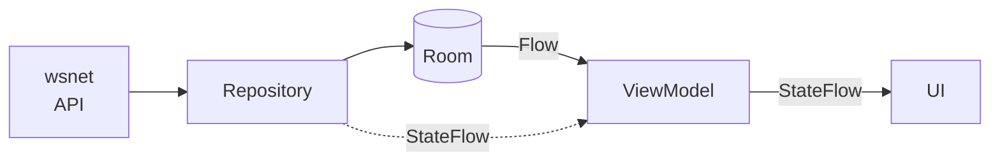
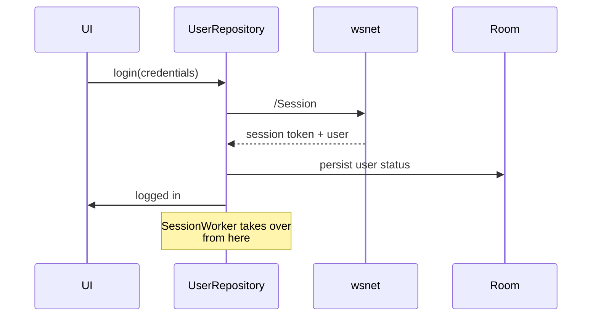

# Data Flow

How data moves through the app: where it comes from, where it is stored, and how the UI hears about
changes.

The VPN connection path is **not** here — see [VPN_BACKEND.md](VPN_BACKEND.md).

---

## 1. The four sources

| Source | What | Accessed through |
|---|---|---|
| **API** | Session, server list, credentials, notifications, port map | `wsnet` (prebuilt AAR) via `WSNetWrapper` and the repositories |
| **Room** | Servers, locations, favourites, latency, notifications, excluded IPs | `WindscribeDatabase` (v43) and its DAOs |
| **DataStore** | Preferences | `PreferencesHelper`; keys in `DataStoreKeys` |
| **In-memory** | Connection status, service mode, network identity | `VPNConnectionStateManager`, `NetworkInfoManager`, `DeviceStateManager` |

Preferences were migrated off Tray; `TrayToDataStoreMigration` runs once at startup
(`Windscribe.runTrayMigrationEarly`) and the legacy key names survive as the mapping in `DataStoreKeys`.

---

## 2. The shape of a data update



Repositories own the write path. They call the API, persist to Room, and expose either a Room `Flow`
or their own `StateFlow`. The UI never reads a repository directly; it observes a ViewModel.

Repositories live in `base/.../repository/` — `ServerListRepository`, `UserRepository`,
`LocationRepository`, `LatencyRepository`, `WgConfigRepository` and the rest. `CallResult` is the
common success/error wrapper.

---

## 3. Background work

Scheduled through `WindScribeWorkManager`, which wraps WorkManager. All jobs use unique-work keys:
periodic jobs with `enqueueUniquePeriodicWork`, one-shot refreshes with `enqueueUniqueWork` and
`ExistingWorkPolicy.REPLACE`, so a burst of requests collapses to one run.

| Worker | Purpose |
|---|---|
| `SessionWorker` | Refreshes the session; detects account and user-status changes |
| `ServerListWorker` | Server list and locations |
| `CredentialsWorker` | Per-protocol server credentials |
| `StaticIpWorker` | Static IP list |
| `LatencyWorker` | Ping times |
| `NotificationWorker` | In-app notifications |
| `BootWorker` | Decides whether to connect after boot or an app update |
| `HostnameRefreshWorker`, `RobertSyncWorker`, `UnblockWgParamsWorker` | Feature-specific refreshes |

`SessionWorker` is the one worth knowing. It runs periodically, on demand after an event that could
have changed the account, and every minute while the app is in the foreground. Its result drives
downstream work: a changed user status triggers a server-list refresh, and a location that is no
longer valid triggers a reconnect to an eligible one.

Retry behaviour is `BackoffPolicy.LINEAR` at 10 s, with a `NetworkType.CONNECTED` constraint — so a
worker does not run at all while the device is offline.

---

## 4. State that is not persisted

Connection status and service mode are in-memory only, published from
`VPNConnectionStateManager` as `StateFlow`.

```kotlin
val state: StateFlow<VPNState>                      // status, connectionId, error
val serviceMode: StateFlow<ConnectionPolicy.ServiceMode?>   // why the service is up with no tunnel
```

Two properties of `StateFlow` that this code depends on, and that have caused real bugs when missed:

**Conflation needs value equality.** `StateFlow` drops an emission equal to the current value. A type
that inherits identity equality re-notifies on every emit, and one that is mutated in place notifies
on none. Anything published this way must be a `data class` with `val` fields.

**Service mode is cleared by a connect.** `setState` clears it whenever it receives a
non-`Disconnected` status; only `AutoConnectWatcher` and `WindVpnController.onAccountRecovered` clear
one directly. That constrains what a mode may claim — see [VPN_BACKEND.md](VPN_BACKEND.md) §4.

---

## 5. Login and session



`UserRepository.whatChanged(session)` compares a fresh session against stored state and reports which
of user status, account status, email status or migration changed. That comparison is what decides
whether a session refresh causes any downstream work at all.

---

## Related

- [VPN_BACKEND.md](VPN_BACKEND.md) — the connection path
- [MODULE_STRUCTURE.md](MODULE_STRUCTURE.md) — where each layer lives
- [DEBUGGING.md](../workflows/DEBUGGING.md) — reading the logs these produce
