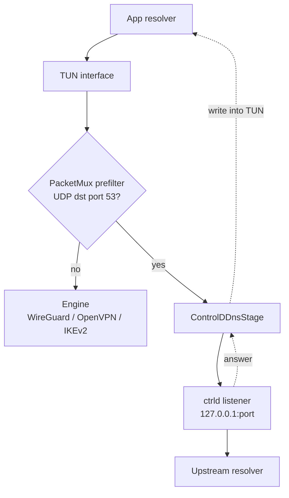

# DNS Interception

How DNS queries from apps are routed through Control D (`ctrld`) while the VPN is up.

The short version: `PacketMux` classifies every packet leaving the TUN with an inline prefilter.
UDP/53 goes to `ControlDDnsStage`, which resolves it against a local `ctrld` listener and writes the
answer back into the TUN. Everything else goes straight to the engine. DNS is a **separate failure
domain** — if the stage dies, stalls or throws, the mux keeps forwarding traffic.

---

## 1. The path

`ctrld` runs in-process as a Go library (`CdLib`), configured by `ProxyDNSManager` and listening on
`127.0.0.1`. Its port is chosen at runtime from `10000..32767` rather than fixed, with up to 20
attempts to find a free one; `ProxyDNSManager.getListenPort()` reports the live value.

---

## 2. Why the stage is off the data path

The mux prefilter is inline and cheap — it reads the IP and UDP headers and nothing else. Only packets
that match UDP/53 are handed to the stage, and the handoff is a non-blocking `offer` onto a bounded
queue (`QUEUE_DEPTH` = 512).

That structure is deliberate: **backpressure is a drop, never a wait.** A DNS stage that stalled while
holding the pump would stop all traffic, so a full queue drops the query and lets the resolver retry.
`PacketMux` also wraps every call into the stage — `start`, `onEngineAttached`, `stop` — so a stage
that throws is logged and bypassed rather than taking the tunnel down with it.

| Bound | Value | Purpose |
|---|---|---|
| `QUEUE_DEPTH` | 512 | Inbound query queue. Full queue drops. |
| `MAX_PENDING` | 4096 | In-flight queries. Bounds memory and transaction-ID exhaustion under a flood. |
| `QUERY_TIMEOUT_MS` | 5000 | How long an unanswered query is retained. |
| `RECEIVE_TIMEOUT_MS` | 200 | Socket read timeout on the response thread. |
| `RESPONSE_BUFFER_BYTES` | 4096 | Response read buffer. |

---

## 3. Two details that are easy to get wrong

**Responses are forwarded byte-for-byte, with only the two ID bytes patched.** They are never
re-encoded through minidns. Re-encoding would destroy name compression, unknown resource records and
DNSSEC byte-exactness — a response has to reach the app as the upstream wrote it.

**In-flight queries are keyed by the transaction ID the stage assigned, not the one the app chose.**
A DNS response carries only an ID. Two apps can independently pick the same ID, so matching on
app-chosen IDs would make them indistinguishable and could deliver one app's answer to the other.

---

## 4. Limits

| Limit | Detail |
|---|---|
| TCP/53 is not intercepted | The prefilter matches UDP only. A `TC=1` retry over TCP reaches the engine unmodified. |
| DoT and DoH are not intercepted | Same reason — they are not UDP/53. They bypass `ctrld` entirely. |
| Nothing is carried through a block | The blocking interface publishes no DNS servers. See [VPN_BACKEND.md](VPN_BACKEND.md) §3. |

---

## Source map

| Concern | File |
|---|---|
| Prefilter and failure isolation | `common/.../tunnel/PacketMux.java` |
| Query/response handling | `common/.../tunnel/ControlDDnsStage.java` |
| `ctrld` lifecycle and config | `base/.../backend/ProxyDNSManager.kt`, `CdLib.kt` |
| Config template | `base/src/main/assets/` → `config.toml` |
