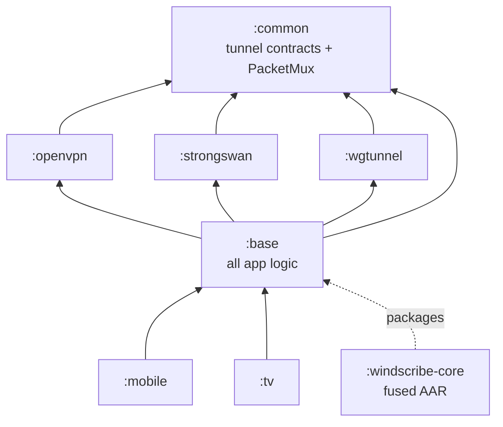

# Module Structure

The Gradle modules, what each is for, and which way the dependencies point.

---

## 1. The graph

| Module | Depends on | Contents |
|---|---|---|
| `:common` | *(nothing)* | Tunnel contracts and the packet mux. |
| `:openvpn` | `:common` | OpenVPN engine + native build (C++, CMake/NDK). |
| `:strongswan` | `:common` | IKEv2 engine, prebuilt charon binaries. |
| `:wgtunnel` | `:common` | WireGuard engine (`wg-go`) and the `ctrld` Go library. |
| `:base` | `:common`, the three engine modules | Every piece of app logic: VPN orchestration, API, database, preferences, workers, state. |
| `:mobile` | `:base`, `:baselineprofile` | Phone and tablet UI. |
| `:tv` | `:base` | Android TV UI. |
| `:windscribe-core` | — | Packages `:base` and everything under it into one self-contained AAR. |
| `:baselineprofile` | — | Baseline profile generation. |

**`:common` deliberately depends on nothing.** That is what lets the three engine modules implement
against `VpnEngine` and `VpnHost` without any of them depending on `:base`, and it is why the tunnel
contracts live there rather than beside the orchestration that uses them.

`wsnet` is **not** a module. It is a prebuilt AAR (`implementation(group = "", name = "wsnet", ext =
"aar")`) providing the networking layer used for all API calls.

---

## 2. `:base` — where the app lives

312 source files. The packages under `com.windscribe.vpn`:

| Package | Contents |
|---|---|
| `backend/` | VPN orchestration. `tunnel/` holds the service; `wireguard/`, `openvpn/`, `ikev2/` hold the per-protocol backends; `utils/` holds `WindVpnController`. |
| `state/` | `ConnectionPolicy`, `VPNConnectionStateManager`, `NetworkInfoManager`, `DeviceStateManager`. |
| `autoconnection/` | `AutoConnectionManager` — the protocol failover walk. |
| `api/`, `wsnet/` | API surface and the wsnet wrapper. |
| `localdatabase/` | Room database, DAOs and entities. |
| `apppreference/` | Preferences, on DataStore. `DataStoreKeys` maps the legacy Tray keys across. |
| `repository/`, `serverlist/` | Data repositories and the server list. |
| `workers/` | WorkManager jobs — session refresh, server list, notifications. |
| `di/` | Dagger modules. |
| `billing/`, `alert/`, `installer/`, `decoytraffic/`, `mocklocation/` | Feature areas. |

The VPN backend inside `backend/` is documented on its own in
[VPN_BACKEND.md](VPN_BACKEND.md) — read that rather than inferring the design from the package layout.

---

## 3. `:mobile` and `:tv`

Two separate UI modules over one `:base`. They are not variants of each other: TV has its own
navigation, its own layouts, and no system killswitch to integrate with.

Where a behaviour is shared it lives in `:base` and both inherit it. Where the UI must differ, it
differs in the module. Service states are a current example — `:base` publishes the full set, and the
TV UI renders several of them as plain disconnected.

---

## 4. Flavors

| Module | Flavors |
|---|---|
| `:base` | `fdroid`, `google`, `whitelabel` |
| `:mobile` | `fdroid`, `google` |

`fdroid` is the plain build with no partner integration. `google` adds the Play-dependent pieces.
`whitelabel` is the build distributed as the `windscribe-core` AAR for a partner UI to sit on.

Build a debug APK with `./gradlew :mobile:assembleFdroidDebug`.

---

## 5. `:windscribe-core`

Uses the fused-library plugin to merge classes, resources, manifests, JNI, assets and ProGuard rules
from `:base` and everything it is built on, rewriting the embedded R classes so a consumer needs
nothing from this repository beyond the AAR.

Third-party dependencies (AndroidX, Room, OkHttp, …) are deliberately **not** fused — embedding them
would collide with the consumer's own copies. The consumer declares them itself;
`./gradlew :windscribe-core:report` prints the exact list.

Build with `./gradlew :windscribe-core:bundle`; the AAR lands in `build/outputs/aar`. Nothing is
published from here.

---

## 6. Native code

| Module | Language | Build |
|---|---|---|
| `:openvpn` | C++ | CMake + NDK, built from source in `src/main/cpp/`. See [OPENVPN_UPDATE.md](../guides/OPENVPN_UPDATE.md). |
| `:strongswan` | C | Prebuilt `.so` binaries; sources kept in `strongswan-src/`. |
| `:wgtunnel` | Go | `wg-go` and `ctrld`, compiled to `.so`. |
