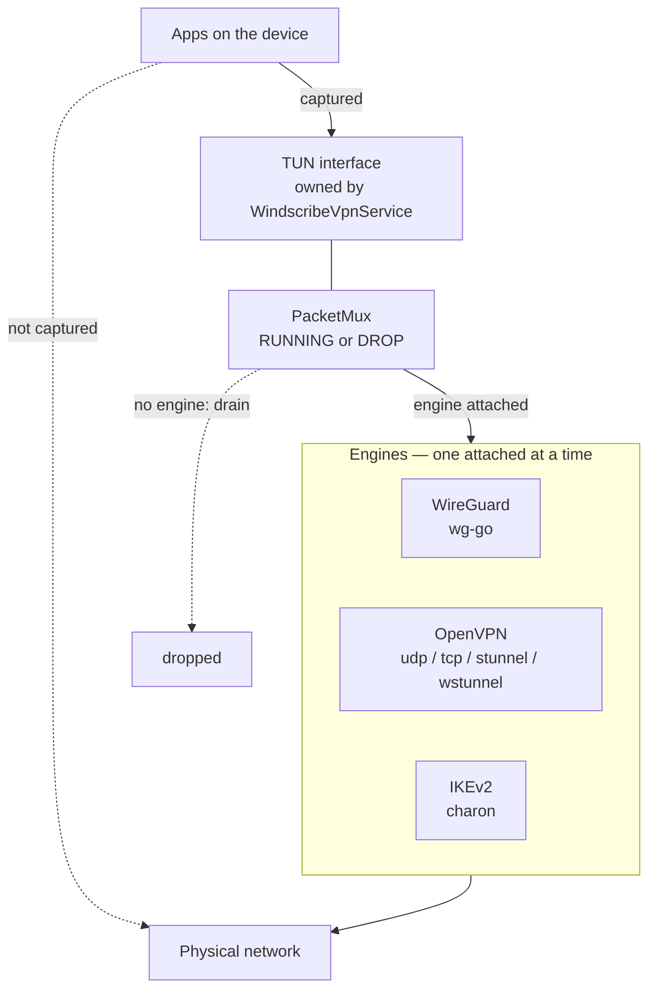
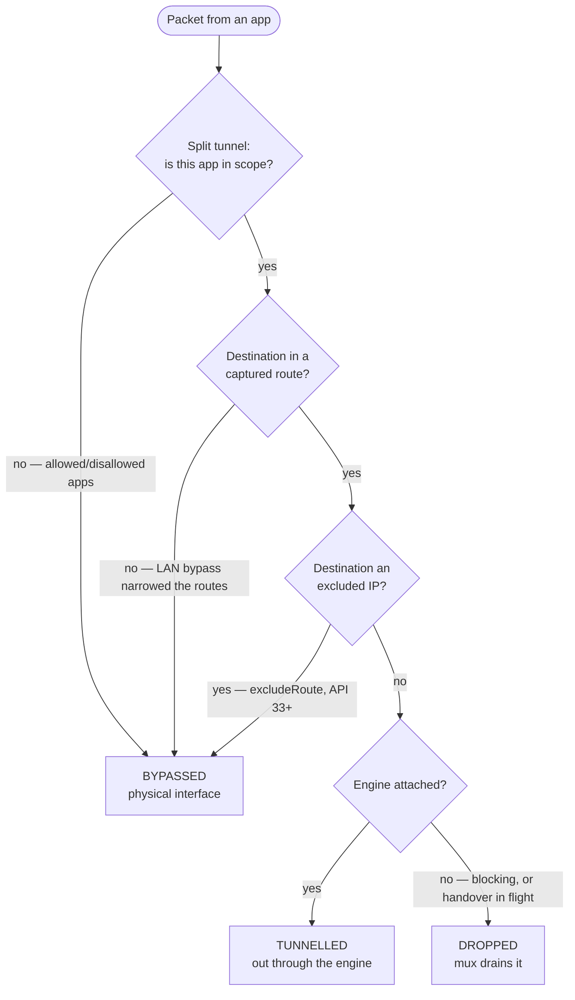
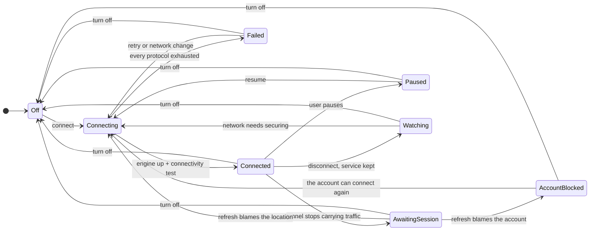
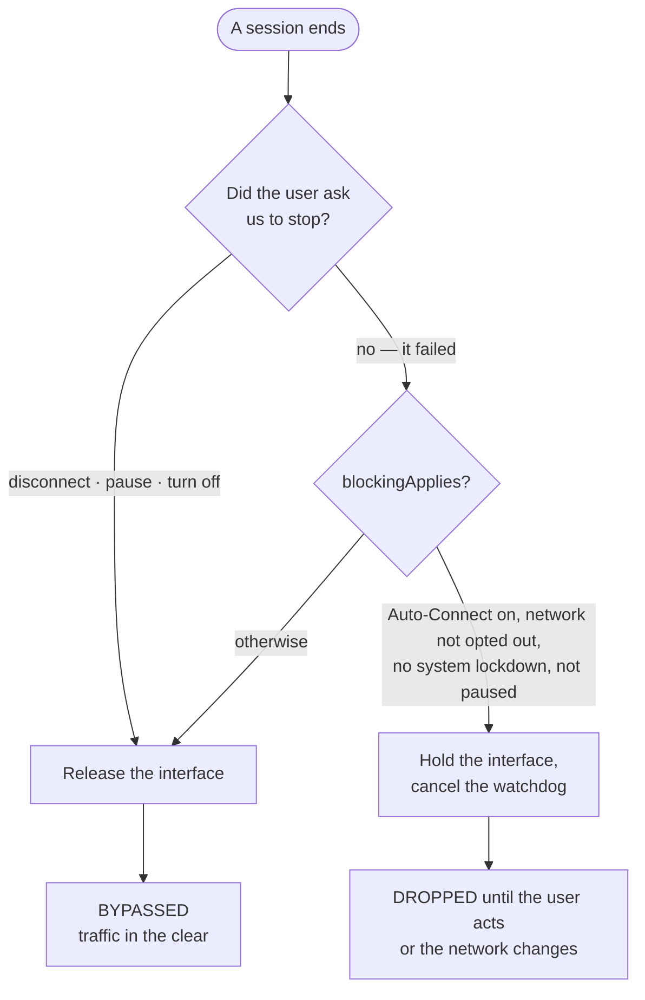
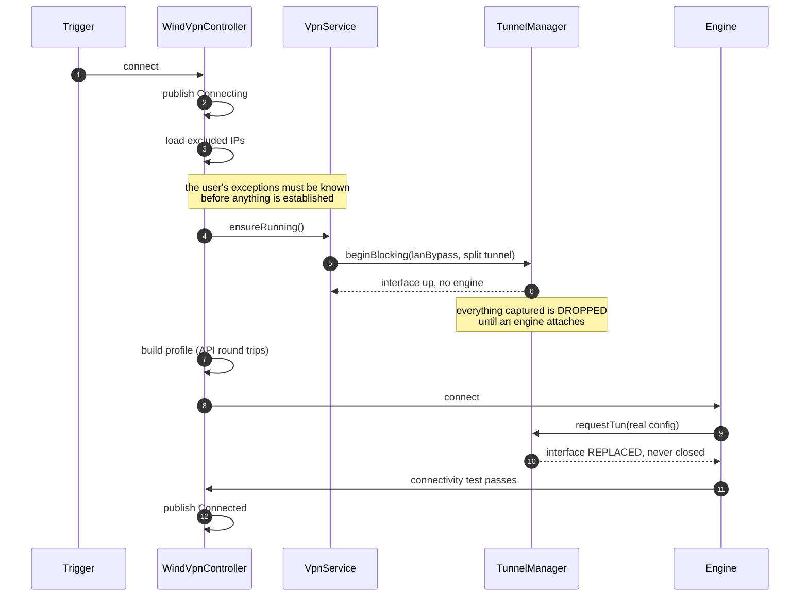
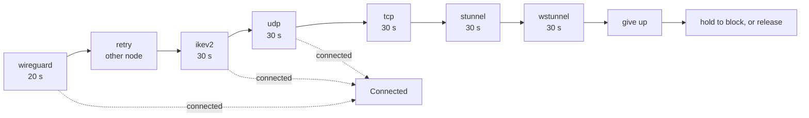

# VPN Backend

How the Windscribe Android VPN backend works: what owns the network interface, how the protocol
engines attach to it, and who decides when to connect, block, or stand down.

Read §1 and §2 first. Everything after that is detail on one of the pieces they introduce.

---

## 1. The one idea

**One service owns the TUN interface for an entire session. Protocol engines are plain objects that
attach to it and detach from it.**

`WindscribeVpnService` is the only `android.net.VpnService` in the app. WireGuard, OpenVPN and IKEv2
are `VpnEngine` implementations behind `PacketMux`. Switching protocol detaches one engine and
attaches another; the interface itself never closes.

Because the interface outlives any single connection attempt, it can be **held** — kept established
with no engine behind it. A held interface still captures every packet it is configured to capture and
has nothing to carry them, so they are dropped. That single property is what implements failover
without a leak window, and blocking mode without a separate killswitch mechanism.

Every user-facing feature in this backend reduces to **one question asked about one packet**:

| Fate | Condition |
|---|---|
| **TUNNELLED** | Captured by the interface, and an engine is attached. |
| **BYPASSED** | Never captured. Leaves on the physical interface in the clear. |
| **DROPPED** | Captured, but no engine is attached. `PacketMux` drains it. |



---

## 2. The pieces

| Component | Module | Responsibility |
|---|---|---|
| `WindscribeVpnService` | `:base` | The only `VpnService`. Owns the TUN, the foreground notification, and the service lifecycle. |
| `VpnServiceGate` | `:base` | Holds the running service so callers can `await()` one. Starting a service is asynchronous; only the service can call `establish()`. |
| `TunnelManager` | `:common` | Attaches and detaches engines, decides when the interface is built, replaced, held or released. |
| `PacketMux` | `:common` | Moves packets between the TUN fd and the attached engine's fd. `RUNNING` or `DROP`. |
| `VpnEngine` | `:common` | One protocol. `start(profile, fd)` / `stop()`. |
| `WindVpnController` | `:base` | Orchestration: what to connect to, in what order, and when to give up. |
| `AutoConnectionManager` | `:base` | The failover walk across protocols. |
| `ConnectionPolicy` | `:base` | Every connect/disconnect/block decision, as pure functions. |
| `VPNConnectionStateManager` | `:base` | Publishes connection status and service mode. |

`:common` is deliberately free of app dependencies — it holds the contracts and the mux, so the engine
modules (`:wgtunnel`, `:openvpn`, `:strongswan`) can implement against it without depending on `:base`.

### Contracts

```kotlin
// common/.../tunnel/VpnHost.kt — implemented by WindscribeVpnService
interface VpnHost {
    val hostContext: Context
    fun protect(socketFd: Int): Boolean
    fun requestTun(config: TunConfig): ParcelFileDescriptor
    fun currentTunConfig(): TunConfig?
    fun releasePreviousTun()
    fun releaseTun()
    fun isSystemLockdownEnabled(): Boolean
    fun onEngineStopped(engineId: String, reason: StopReason, detail: String?)
    fun dnsDetails(): DNSDetails?
    fun controlDPort(): Int
}

// common/.../tunnel/VpnEngine.kt — implemented per protocol
interface VpnEngine {
    fun start(profile: EngineProfile, tunFd: Int)
    fun stop()
    fun onRevoked()
}
```

`TunConfig` describes the interface: `addresses`, `routes`, `dnsServers`, `mtu`, `allowedApps`,
`disallowedApps`, `blocking`. `TunnelManager.connect()` compares the requested config with the live one
and **replaces** the interface in place rather than closing and rebuilding it when they differ.

---

## 3. Where each packet goes

The three bypass features are all **capture** decisions, expressed on the `VpnService.Builder` when the
interface is built. Only the last gate concerns the tunnel. Nothing is special-cased downstream.



| Feature | Mechanism | Scope | Constraint |
|---|---|---|---|
| Split tunnel | `addAllowedApplication` / `addDisallowedApplication` | per app | Mutually exclusive. A config carrying both is rejected by the builder. |
| LAN bypass | `routes = TunConfig.PUBLIC_ROUTES_V4` | `10/8`, `172.16/12`, `192.168/16` | Off by default. The *gap in the route list* is the bypass. |
| Excluded IPs | `builder.excludeRoute()` | per prefix | API 33+ only; silently absent below that. |
| Blocking | interface held with no engine | everything still captured | Honours all three above — those are the user's own exceptions. |

**DNS is not carried through a block.** The blocking interface publishes no DNS servers, and the
resolver's own address is subject to the same capture rules. On Wi-Fi with LAN bypass on, a router at
`192.168.x.1` stays reachable. On cellular the resolvers are public IPv6 and the interface drops IPv6
wholesale, so name lookups fail. Excluded *hostnames* work only because `ExcludedIpHolder` resolves
them to literal IPs ahead of time and caches them.

---

## 4. Connection status and service mode

These are **separate axes**. Status describes the tunnel. Service mode describes why the service is
alive without one. A paused service and a watching service both report status `Disconnected`, which is
why they cannot be one enum.

`ConnectionPolicy.ServiceMode`:

| Mode | Interface | Traffic | Notification | Actions |
|---|---|---|---|---|
| `Off` | none | BYPASSED | *(service stopped)* | — |
| `Watching(reason)` | none | BYPASSED | depends on reason, below | Connect · Turn off |
| `Paused` | **closed** | BYPASSED | "Paused — your traffic is not protected" | Resume · Turn off |
| `NoNetwork` | none | BYPASSED | "No network — nothing to connect over" | Connect · Turn off |
| `AwaitingSession` | held if blocking applies | DROPPED | "Awaiting session update" | Turn off |
| `AccountBlocked(status)` | held if blocking applies | DROPPED | "Account expired — turn off Windscribe to restore internet, then upgrade" | Turn off |
| `AuthFailed` | held if blocking applies | DROPPED | "Authentication failed — check your config" | Retry · Turn off |
| `Failed(blocking)` | held if `blocking` | DROPPED | "Couldn't connect — traffic is blocked" / "Couldn't connect to X" | Retry · Turn off |

`WatchReason` picks the copy for `Watching`:

| Reason | Meaning | Notification |
|---|---|---|
| `NetworkNotSecured` | Auto-Connect is on and this network was not opted out. | "Not connected — will connect automatically" |
| `NetworkOptedOut` | Auto-Secure is off for this network. Also marks a session Auto-Secure took away, for the next secured network to give back. | "Auto-secure is off for X" |
| `StoodDownByUser` | The user disconnected here, so we do not immediately reconnect. | "Auto-connect is off for X" |



### Two rules that constrain every mode

**A mode is cleared by a connect.** `VPNConnectionStateManager.setState` clears the mode when it
receives any non-`Disconnected` status. Two callers clear one directly: `AutoConnectWatcher` drops a
stale `Failed` or `NoNetwork` when a network arrives, and `WindVpnController.onAccountRecovered` drops
`AccountBlocked`. Everything else published here stands until a connection starts.

A mode that *predicts* — "will reconnect shortly" — is stuck standing if that prediction fails, so
modes state what is true rather than what will happen. `AwaitingSession` says "Awaiting session
update", which holds for as long as the refresh takes.

**Pause closes the interface rather than holding it empty.** A `VpnService` that has not called
`establish()` is an ordinary `Service`: no interface, no key icon, nothing captured. That is what makes
pause a genuine pass-through instead of a black hole. It is refused under Android's own always-on
lockdown, where dropping the interface would blackhole the device.

### How a session ends

`ConnectionPolicy.serviceModeAfterSession(input, end)` is the only place that maps an ending to a mode.

| `SessionEnd` | Mode |
|---|---|
| `UserTurnOff` | `Off` |
| `UserPause` | `Paused` |
| `NoNetwork` | `NoNetwork` |
| `AwaitingSession` | `AwaitingSession` |
| `ConnectFailed` | `Failed(blocking = shouldBlockOutsideVpn(...))` |
| `UserDisconnect`, `SystemDisconnect` | `Off` if nothing to watch, else `Watching(reason)` |

An account that cannot connect overrides the table for every end the user did not ask for:
`AccountBlocked` with Auto-Connect on, `Off` without it, since there is then no kill switch and nothing
to watch for.

`NoNetwork` and `AwaitingSession` are independent of Auto-Connect: the service stays up either way,
because the state is something the user needs to see.

### Undoing an Auto-Secure teardown

`shouldAutoDisconnect` fires regardless of Auto-Connect, so its undo does too — otherwise Auto-Secure
is a one-way door for everyone with Auto-Connect off, which is the default. A teardown of a session
the user asked for settles as `Watching(NetworkOptedOut)` rather than `Off`, and that mode is what
`shouldAutoConnect` reads to connect again on the next network we secure.

Both halves are gated on `globalUserConnectionPreference`, which is only true for a session the user
started and has not ended, and on the network not being stood down — a hand disconnect on an
opted-out network is the user's own decision and still stops the service. The reconnect is stricter
than ordinary auto-connect: it needs `isAutoSecureOn == true`, never an unnameable network, because
it is overriding a setting the user turned off.

It is one attempt. Starting a connect clears the mode, so a network that refuses is not retried; the
next teardown arms it again.

### Whose fault the drop was

A tunnel that stops carrying traffic cannot say whether the location died or the account did — a
WireGuard peer goes silent for both, and a rejected IKEv2 or OpenVPN handshake means either. So
`BrokenTunnel` and `AuthenticationError` end the session as `AwaitingSession` and request a session
refresh.

Only a session that came up waits. The same errors from a handshake that never completed end as
`ConnectFailed`, because reconnecting would meet the same rejection and the verdict would order it
again on every pass. The refresh is still requested, since a rejected handshake is also how an account
that lapsed first shows itself.

| The refresh says | Result |
|---|---|
| the account is Okay | the location was at fault — `SessionWorker` reconnects through `AutoConnectionManager.connectInForeground`, so a rejected handshake refreshes credentials and a failure walks the protocol list |
| expired or banned | `AccountBlocked` |
| nothing yet | the wait stands, blocking, until it does |

A config the user supplied is exempt from all of this. It authenticates against a third party, so no
account state of ours bears on it and the refresh has nothing to say: a rejection ends the session as
`AuthFailed` — "Authentication failed — check your config" — and no refresh is requested.

The exemption runs through every account check: `shouldAutoConnect`, `shouldWatch`,
`serviceModeAfterSession`, `SessionWorker`'s disconnect, `ReconnectAfterRefresh`, and
`ShortcutStateManager.load`. Expired or banned, the config keeps working and the service keeps
watching for it.

A connect reads the server list and the server credentials, and the session response is what says
whether either is stale. `SessionWorker` refreshes them in that order and awaits both before anything
reconnects — separate workers finish in an order nobody controls, and a pro account dropping to free
reconnected on a fresh server list with the credentials of the account it no longer had.

`ReconnectAfterRefresh` is the single decision that follows, shared with `ServerListWorker`: it moves
the user off a location they have lost, off a node that is no longer eligible, or back onto the one
they dropped from.

---

## 5. Holding the interface

`TunHold` decides what happens to the interface when an engine stops.

| Hold | Why | Bound | Ends when |
|---|---|---|---|
| `None` | Nothing more is coming and nothing should be blocked. | — | Released immediately. |
| `ForHandover` | An engine is being swapped and another is about to attach. | `HOLD_TIMEOUT_MS` = 90 s | The next engine attaches. The watchdog firing means a reconnect was lost — it is logged as such, the interface closes, and the session end that follows establishes a blocking one when the mode calls for it. |
| `ForBlocking` | Nothing is coming. That is the point. | unbounded | The user retries or turns off, or the network changes. |

These two holds look identical from outside and are not. A give-up path that leaves the interface on
the *handover* hold produces a device that unlocks itself 90 seconds later. Every give-up path must
therefore call `endSession`, which asks the policy and either converts the hold or releases it
deliberately.

### Blocking mode

Blocking is the promise attached to Auto-Connect: *connect me always, and let nothing out that I did
not choose.* Because a held interface with nobody coming for it is an outage, whoever stops driving has
to say so explicitly.



`shouldBlockOutsideVpn(input, end)` is `!userAskedUsToStop && blockingApplies(input)`, where the user
asking covers exactly `UserDisconnect`, `UserPause` and `UserTurnOff`. Every other ending — including
`ConnectFailed` and `AwaitingSession` — blocks if `blockingApplies`.

An account that can no longer connect is deliberately not an exception. Auto-Connect is a kill switch,
and expiry is not a reason to put held traffic on the wire; `AccountBlocked` names the way out instead,
which is Turn off. That matters because the block covers the Play Store too, so upgrading has to follow
turning off rather than replace it.

---

## 6. A connection, from tap to tunnel

Ordering matters. Everything the user has already decided — split tunnel, LAN bypass, excluded IPs —
must be loaded **before** the first interface is established, because the blocking interface is
established first and inherits whatever is known at that moment.



Starting the service *before* the profile is built is what keeps the cold-start window short: the block
engages in tens of milliseconds rather than after the API round trips.

---

## 7. Failover

A failed attempt walks the protocol list in order, holding the interface throughout so nothing escapes
between attempts. Only the first protocol retries a different node.



Budgets live in `VpnBackend`: `WG_CONNECTING_WAIT` = 20 s, `CONNECTING_WAIT` = 30 s.

### The silent-server budget

OpenVPN reports **nothing at all** when a server never answers, and its own `connect-timeout` defaults
to 120 s — four times our budget — so inside our window it will neither retry nor report. The
distinction is already in the state stream: `VpnStatus.getLevel` maps `WAIT`/`TCP_CONNECT`/`RESOLVE` to
*no reply yet* and `AUTH`/`GET_CONFIG`/`ASSIGN_IP` to *server replied*.

| Phase | Meaning | Budget |
|---|---|---|
| `NO_SERVER_REPLY_YET` | Nothing has come back at all | `NO_SERVER_REPLY_WAIT` = 12 s — one round trip, with margin |
| `SERVER_REPLIED` | The handshake is progressing | 30 s — the expensive, variable work lives here |

### WireGuard traffic monitor

`TunnelTrafficMonitor` covers the case a connect timeout cannot: a tunnel that came up and later
stopped passing traffic. WireGuard is silent about this — a peer that stops answering looks the same
whether the account lapsed, the node died or the network moved.

`PacketMux` counts plaintext packets in both directions at the TUN boundary,
`TunnelManager.traffic()` exposes a reading, and the monitor samples every 5 s. DNS the stage answered
locally is counted in neither direction, and wg keepalives never reach the TUN at all.

The measurement is a **silence streak** — time since the last packet that came back, carrying the
egress spent since. Egress is context, never a condition: a break decays to nothing within two
minutes. `Offline`, `Held` and `Warmup` end a streak; none is the tunnel's doing.

#### Corroborating a silence

Silence alone cannot tell a dead tunnel from an idle one, since keepalives never reach the TUN either
way. `GoBackend.getCurrentStatistics()` does see them: it reads the peer's `rx_bytes`, `tx_bytes` and
last handshake time straight off wg-go's UAPI, and the monitor samples them beside the mux counters.

Past `CANDIDATE_SILENCE_MS` (120 s) the silence must be corroborated by all three of those sitting
unchanged for `PEER_SILENT_MS` (190 s). wg's `REJECT_AFTER_TIME` is 180 s and the profile's 25 s
keepalive has to send inside that, so a peer that is answering cannot go this long without a rekey
moving one of them.

Staleness is measured on `elapsedRealtime` from the last sample that differed, not from the handshake
timestamp itself, which is wall clock and can jump. `Offline`, `Held` and `NoTunnel` reset it —
corroboration has to be earned inside the window it judges.

When both hold the monitor logs `BROKEN TUNNEL` and ends the session once, as `BrokenTunnel` — the
ending a rejected IKEv2 or OpenVPN handshake takes, so §4 applies unchanged. `BROKEN TUNNEL CLEARED`
means it fired on a tunnel that recovered by itself. Those two are the only lines it writes; a session
that stays up says nothing.

It runs for WireGuard only, and not for a user-supplied config, which answers to someone else.

### Failing over needs a foreground Activity

The protocol walk beyond the first attempt is driven from the UI. In the background a failure surfaces
as `Failed` with a Retry action rather than walking the list — and Retry is a single attempt, not
another walk.

---

## 8. Who decides

`ConnectionPolicy` is a pure object with no Android or coroutine dependencies, which is what makes
these rules testable (`ConnectionPolicyTest`). Every caller reads its inputs through
`ConnectionPolicyInputs` and asks the policy; none of them re-implement a condition locally.

| Function | Answers |
|---|---|
| `shouldConnectOnStart` | Do we connect on boot or after an app update? |
| `shouldAutoConnect` | Should we secure this network now? |
| `shouldAutoDisconnect` | Has the user opted this network out while we are connected? |
| `shouldSwitchProtocol` | Is the wrong protocol running for this network? |
| `shouldBlockOutsideVpn` | Does this ending lock the device? |
| `blockingApplies` | Is blocking in force, independent of any ending? |
| `standsDown` | Has the user told us to leave this network alone? |
| `shouldWatch` | Should the service stay up with no tunnel? |
| `serviceModeAfterSession` | What is the service doing now that this session is over? |
| `reconcile` | An input nothing observes has changed — connect, watch, or stop? |

Auto-Connect and the account status are read where a decision is made and never watched, so changing
either leaves the present untouched. `reconcile` is what applies them, from the Auto-Connect toggle
(`onAutoConnectChanged`) and from an account that starts working again (`onAccountRecovered`).

**Boot priority reads in one direction: Auto-Connect > Start on boot > "you were connected".**
Auto-Connect outranks the boot switch, because a reboot does not suspend the promise it makes — and
that is what carries blocking across a restart. "You were connected" starts nothing by itself: it is
true for anyone who has not explicitly disconnected, so honouring it made *Start on boot* a switch that
did nothing when turned off. An app update is the exception, because that is the app restarting rather
than the device.

### Auto-Connect without a network name

Reading the network name needs location permission. Without it `isAutoSecureOn` is unknown, not false —
so `networkAllowsAutoConnect` treats an unknown network as securable. Auto-Connect means connect; it
does not mean connect only where we can name the network.

A stand-down must survive the same gap, so `DeviceStateManager.standDownCurrentNetwork()` records one
whether or not there is a name to key it to, and `standsDown` reads only that. It is deliberately not
inferred from `globalUserConnectionPreference`: that is equally false for someone who has never
connected, which read every fresh install as a stand-down and left Auto-Connect unable to fire until
the user connected once by hand.

The global **Auto-Secure new networks** setting is not consulted at this point, and should not be
added here. `NetworkInfoManager` creates a row for every network the moment it is first seen, seeded
from that setting via `getDefaultNetworkInfo()`, so its value is already in `isAutoSecureOn` by the
time any decision is made. Reading it again would put one rule in two places and would override
per-network choices the user has made since.

---

## 9. Service lifecycle

The service is started with an action and stopped only through `endSession`.

| Action | Effect |
|---|---|
| `ACTION_CONNECT` | Start and connect. |
| `ACTION_WATCH` | Start with no tunnel, to watch the network. |
| `ACTION_DISCONNECT` | Tear the tunnel down; the policy picks the mode. |
| `ACTION_PAUSE` | Stop the engine, close the interface, stay foreground. |
| `ACTION_RESUME` | Connect to the remembered location and protocol. |
| `ACTION_TURN_OFF` | `stopSelf()`. |
| `ACTION_NOTIFICATION_DISMISSED` | The user swiped the notification away. |

Two lifecycle hazards the code guards explicitly:

- **`VpnServiceGate.isStopping`** is set *before* the terminal state is published. Android tears the
  service down some milliseconds after `stopSelf()`; anything reacting to that state in between would
  otherwise see a service that is still attached but already leaving, and post a notification that
  outlives its service.
- **`detach(instance)` is identity-checked.** A replacement service can attach before the outgoing
  one's `onDestroy` runs. An unconditional clear would orphan the live service, and everything reaching
  it through `current` would silently do nothing.
- **A dismissed notification comes back while traffic is blocked.** Ongoing foreground notifications
  are dismissible from Android 14, and a held interface with no session means the notification is the
  only way to Turn off. It is posted again in that state and no other.
- **Teardown is bounded.** `onDestroy` and `onRevoke` are main-thread callbacks, and everything
  `detachHost()` runs from them has a ceiling: `PacketMux.stop()` joins its pumps with a timeout, and
  `wgTurnOff` waits 2 s for wg-go's device to shut down before abandoning it. An engine that overruns
  `VpnEngine.STOP_BUDGET_MS` is logged by name, because a thread stuck inside Go unwinds to a single
  frame and an ANR report cannot name it.

---

## 10. Known limits

| Limit | Detail |
|---|---|
| Excluded IPs need API 33+ | `builder.excludeRoute()` does not exist below that; the feature is silently absent. |
| Failover needs the foreground | In the background a failure settles into `Failed` with a Retry action rather than walking the protocol list. |
| `WSTunnelLib.stop()` blocks | Roughly 90 s on shutdown. Upstream fix needed. |
| A post-reply `DOWN` costs the full budget | Once OpenVPN reports `SERVER_REPLIED` the 30 s budget applies, even if the server then goes quiet. |
| TV shows fewer states | `Paused`, `Watching` and the rest render as plain disconnected in the TV UI. |
| Notification copy is English-only | The service-state strings have no translations. |

---

## Appendix: source map

| Concern | Files |
|---|---|
| Service | `base/.../backend/tunnel/WindscribeVpnService.kt` — the only `android.net.VpnService`. Plus `VpnServiceGate.kt`, `AutoConnectWatcher.kt` |
| Orchestration | `base/.../backend/utils/WindVpnController.kt`, `backend/VpnBackendHolder.kt`, `backend/VpnBackend.kt` |
| Failover | `base/.../autoconnection/AutoConnectionManager.kt` |
| Tunnel health | `base/.../backend/wireguard/TunnelTrafficMonitor.kt`, `common/.../tunnel/PacketMux.java` |
| Engines | `base/.../backend/{wireguard,openvpn,ikev2}/` |
| Engine parents | `wgtunnel/.../GoBackend.java`, `openvpn/.../core/OpenVPNService.java`, `strongswan/.../logic/CharonVpnService.java` |
| Contracts | `common/.../tunnel/{VpnHost.kt, VpnEngine.kt, TunConfig.kt, TunnelManager.kt}` |
| Mux | `common/.../tunnel/PacketMux.java`, `ControlDDnsStage.java` |
| Policy | `base/.../state/{ConnectionPolicy.kt, ConnectionPolicyInputs.kt, VPNConnectionStateManager.kt}` |
| DNS | `base/.../backend/ProxyDNSManager.kt`, `CdLib.kt` |
| Routes | `base/.../backend/utils/ExcludedIpHolder.kt` |
| Notification | `base/.../backend/utils/WindNotificationBuilder.kt`, `ForegroundServiceHelper.kt` |
| Manifests | `base/src/main/AndroidManifest.xml`, `{wgtunnel,openvpn,strongswan}/src/main/AndroidManifest.xml` |
